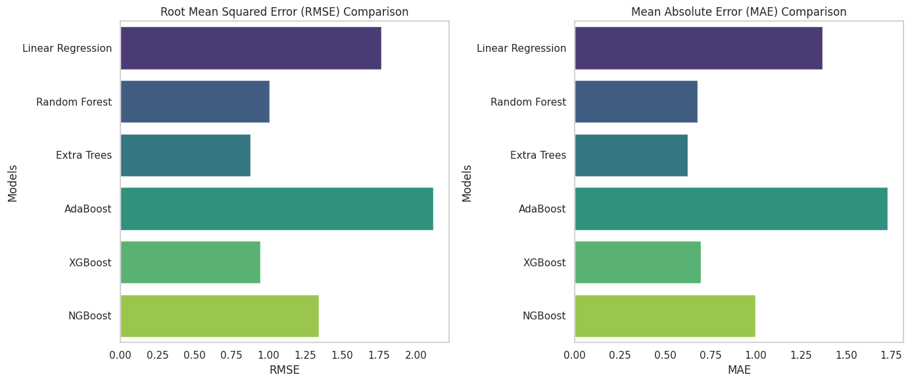

# FIFA Player Analytics & Performance Modeling

### Machine Learning | Regression, Classification & Clustering

An end-to-end notebook study of FIFA 22 player attributes: predict overall ratings, classify highly rated players, and explore clusters of physical, technical, and goalkeeper profiles.

## At a glance

| Area | Overview |
| --- | --- |
| Resume project | FIFA Player Analytics & Performance Modeling |
| Stack | Python, pandas, NumPy, scikit-learn, XGBoost, NGBoost, Matplotlib, Seaborn |
| Dataset | FIFA 22 player records from the FIFA Player Stats Database on Kaggle |
| Tasks | Regression, binary classification, clustering, and PCA-based exploration |
| Main artifact | [ML_Final_Code.ipynb](ML_Final_Code.ipynb), with saved outputs and plots |

## Results at a glance

The tables below reproduce **saved notebook outputs**, not newly rerun experiments. The regression/classification branch retains 15,818 rows after dropping missing values and uses an 80/20 split with `random_state=42`.

### Overall-rating prediction

Lower RMSE and MAE are better. **Extra Trees** has the lowest saved error on both metrics in this comparison.

| Regressor | RMSE | MAE |
| --- | ---: | ---: |
| Linear Regression | 1.767013 | 1.368468 |
| Random Forest | 1.008935 | 0.679020 |
| **Extra Trees** | **0.879723** | **0.626128** |
| AdaBoost | 2.119641 | 1.730547 |
| XGBoost | 0.949505 | 0.695465 |
| NGBoost | 1.343564 | 0.998900 |



### High-rating classification

The positive class is **Overall rating ≥ 80**. On the branch labelled “Original Dataset” in the notebook, the neural network has the highest saved F1 score. This branch includes feature scaling for classification.

| Classifier | Precision | Recall | F1 |
| --- | ---: | ---: | ---: |
| Logistic Regression | 0.959184 | 0.803419 | 0.874419 |
| KNN | 0.918605 | 0.675214 | 0.778325 |
| Kernel SVM | 0.961165 | 0.846154 | 0.900000 |
| Decision Tree | 0.895652 | 0.880342 | 0.887931 |
| **Basic Neural Network** | **0.944444** | **0.871795** | **0.906667** |

The notebook also evaluates Naive Bayes, linear SVM, and a separate PCA/preprocessed branch. Those branch results should not be mixed with this table. The saved original-branch label counts are 15,282 below 80 and 536 at or above 80; class imbalance matters when interpreting the metrics.

### Player clustering

Compares **K-means, K-medoids, and Gaussian mixtures (EM)** using SSE, silhouette, BetaCV, and Dunn scores, with separate physical/technical and goalkeeper analyses. For the three-cluster, z-scaled physical/technical experiment, saved silhouette scores are **0.2733** (K-means), **0.1540** (K-medoids), and **0.2351** (GMM). These are exploratory groups, not validated player-role labels.

## Analysis workflow

1. Obtain FIFA player records and select the FIFA 22 data.
2. Inspect missing values and remove unsuitable or target-derived columns.
3. Explore numerical features, scaling, and PCA transformations.
4. Compare six regression models using RMSE and MAE.
5. Compare seven classification models using precision, recall, and F1.
6. Study player clusters and visualise feature relationships.

## Run locally

```powershell
python -m venv .venv
.\.venv\Scripts\Activate.ps1
python -m pip install -r requirements.txt
jupyter notebook ML_Final_Code.ipynb
```

The dependency list is reconstructed from notebook imports and is not an original version-locked environment. Compatibility adjustments may be needed for the older `scikit-learn-extra`/K-medoids implementation.

The notebook's download cell identifies `bryanb/fifa-player-stats-database` on Kaggle and loads `/content/FIFA22_official_data.csv`. Download the dataset separately, configure Kaggle access locally if required, and update that path for your machine. The `!unzip` and `!pip` cells reflect the original hosted-notebook workflow and may need adapting on Windows. Do not commit Kaggle credentials.

## Included artifacts

- [Notebook with saved outputs](ML_Final_Code.ipynb)
- [Assignment report](Machine%20Learning%20Assignment%20Report.docx)
- [Presentation](ML%20Assignment.pptx)
- [Saved regression plot](assets/regression-comparison.png)

## Resume fit and reproducibility

This matches **FIFA Player Analytics & Performance Modeling | Machine Learning** in the resume. It demonstrates data preparation, model comparison, supervised evaluation, dimensionality reduction, and unsupervised exploration.

The original notebook, report, and slides are preserved. No training run was performed for this upload. Some estimator seeds are unspecified, preprocessing is performed before splitting in parts of the notebook, and the transformed branch uses a different row population. Treat the saved numbers as coursework results; a fresh evaluation should fit preprocessing on training data and document consistent splits and dependency versions. The dataset itself is not bundled.
